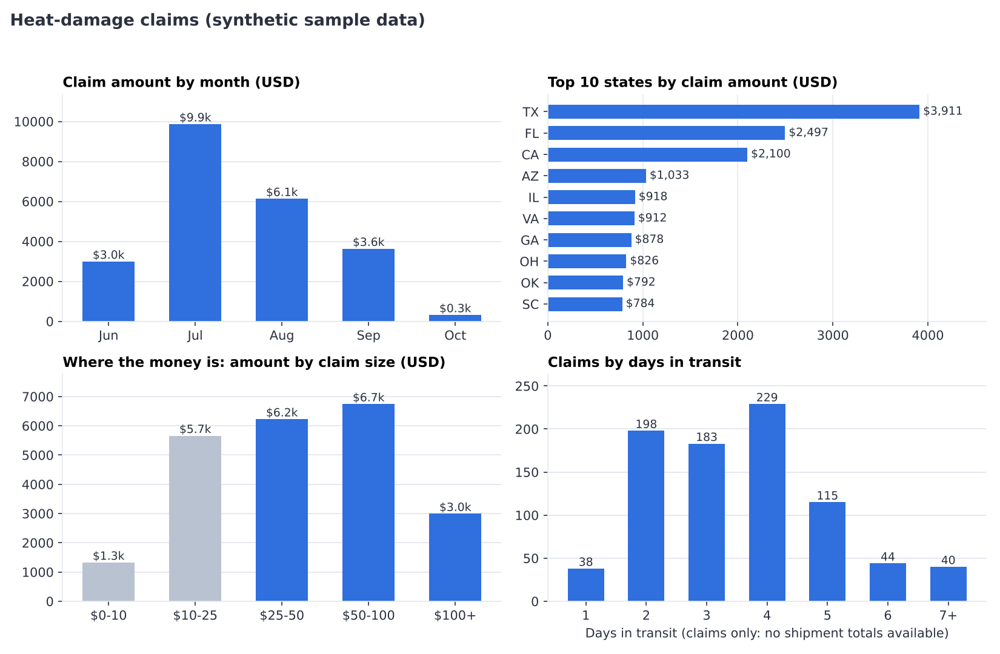
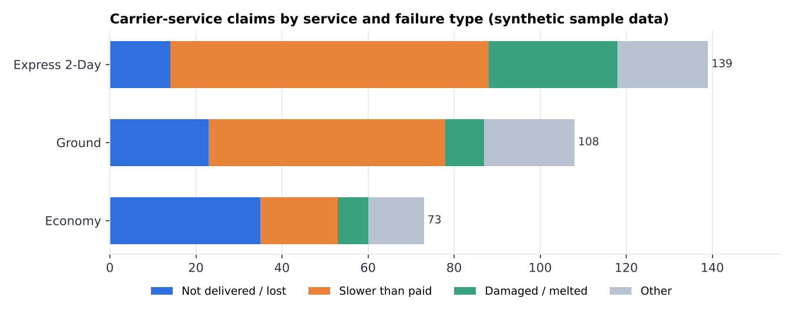

# Shipping Claims Analysis: a pandas + SQL pipeline

Turns messy spreadsheet exports of shipping claims into clean, verified summaries that answer one question: **where do the losses concentrate?**



> **About the data.** Every file in this repository is **synthetic**. It was generated by `src/generate_sample_data.py` to mimic the structure and the mess of real spreadsheet exports. It contains no real customers, orders, carriers or amounts. The project is based on a workflow I built while working in e-commerce operations.

## Why this project

E-commerce teams that ship heat-sensitive products (chocolate, candy) track claims in spreadsheets: melted products, late deliveries, lost packages. Those sheets grow by hand, so they fill up with inconsistent labels, typos, duplicates and blank cells. Before anyone can ask "which regions and services cost us the most?", the data has to be cleaned and the numbers have to be trusted.

## What the pipeline does

1. **Read** CSV or Excel exports and drop empty rows and columns.
2. **Clean** with pandas (see the table below).
3. **Summarize** with pandas: totals by month, state, days in transit, claim size, and failure type by service.
4. **Cross-check with SQL.** The cleaned data is loaded into SQLite and the key numbers are recomputed with queries. If pandas and SQL disagree, the run stops with an error.
5. **Export** summary CSVs. Exports never include order IDs or tracking numbers.

| Problem in the raw data | How it is handled |
|---|---|
| `"NY "`, `"ny"`, `"NY"` as different states | trim whitespace and uppercase |
| `"Carrier A"`, `"carrier a "`, `"CARR C"` | normalize case, spaces and aliases |
| 11 spellings of 3 shipping services | ordered regex rules map them to 3 labels |
| `"."` inside a numeric column | converted to missing instead of crashing |
| Placeholder "Example" row | dropped |
| Exact duplicate rows | dropped, count reported |
| Dates with a wrong year | moved to the most common year, count reported |
| Free-text comments | keyword rules classify them into failure types |
| Missing amount, state or days | kept, and excluded only from the calculations that need them |

## Quickstart

```bash
git clone https://github.com/<your-username>/shipping-claims-analysis.git
cd shipping-claims-analysis

python -m venv .venv
.venv\Scripts\activate          # Windows
# source .venv/bin/activate     # macOS / Linux

pip install -r requirements.txt
python src/generate_sample_data.py
python src/claims_pipeline.py --heat data/sample_heat_damage_claims.csv --service data/sample_carrier_service_claims.csv --out outputs
python src/make_charts.py
pytest
```

To use your own exports, keep the column names in `data/sample_*.csv` (`HEAT_COLUMNS` and `SERVICE_COLUMNS` in `src/claims_pipeline.py`) and pass your files with `--heat` and `--service`. Real data should live outside version control; `.gitignore` excludes `data/private/` and Excel files.

## Example output (synthetic data)

| Metric | Value |
|---|---|
| Heat-damage claims | 900 (858 with an amount) |
| Total claimed | $22,950 |
| Claims above $25 | 296 (34.5% of claims, **69.6% of the money**) |
| Top 5 states | 45.6% of the money |

Carrier-service claims by service and failure type:



## Design decisions and limitations

- **Claims-only data.** The inputs list claims, not all shipments. Without total shipments per state, carrier or transit time, the pipeline can describe how claims are distributed but **cannot compute incidence rates** (claims per 100 shipments), so it makes no claims about which carrier or route is "worse". The natural next step is joining a full shipment export.
- **Strict threshold.** "Large claim" means strictly greater than $25. The bins are right-closed, so exactly $25 is not large. A unit test covers the boundary.
- **Approximate classification.** Failure types come from keywords in free-text comments (`CATEGORY_RULES`). It is transparent and easy to audit, but it will misclassify some comments.
- **Assumption on dates.** A year that differs from the most common year is treated as a typing error. The number of fixed rows is printed on every run.
- **Why a SQL cross-check.** Computing the same totals two independent ways catches silent mistakes, such as rows with missing values that one tool groups and the other drops.

## Project structure

```
shipping-claims-analysis/
├── data/                       synthetic sample inputs (CSV)
├── docs/images/                charts used in this README
├── outputs/                    summary CSVs written by the pipeline
├── src/
│   ├── generate_sample_data.py synthetic, deliberately messy data
│   ├── claims_pipeline.py      read, clean, summarize, SQL cross-check, export
│   └── make_charts.py          matplotlib charts from the summary CSVs
├── tests/test_cleaning.py      unit tests and an end-to-end test
├── requirements.txt
└── LICENSE
```

## Skills demonstrated

Python · pandas · SQL (SQLite) · data cleaning · exploratory analysis · data validation · matplotlib · pytest · documenting assumptions and limits

## Possible next steps

- Join a full shipment export to compute claim rates by carrier, service, state and transit time.
- Add destination temperature data to look for a heat threshold.
- Package the summaries as an interactive dashboard.

## Author

Gabriel Fonseca · [LinkedIn](https://www.linkedin.com/in/gabriel-fernando-fonseca-preciado)
